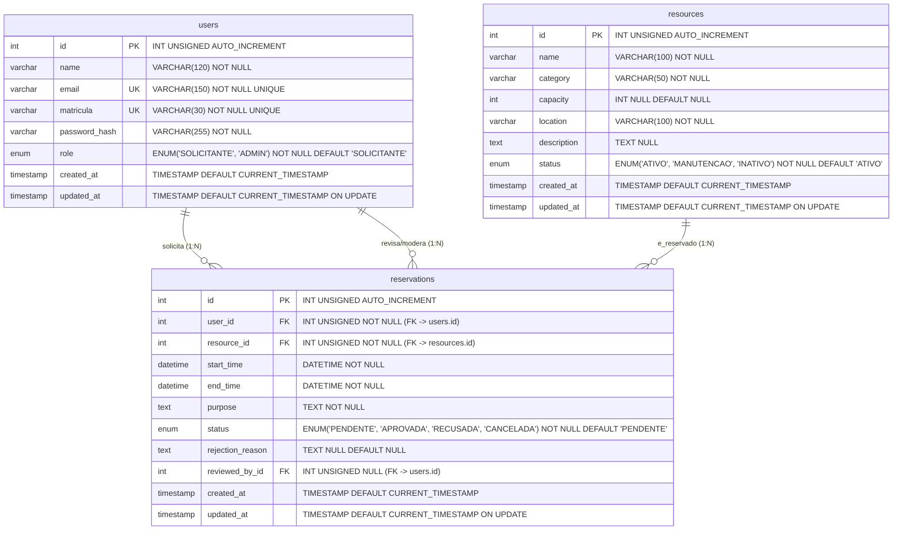

# SisReserva IFRO — Sistema Integrado de Gestão e Reserva de Recursos Didáticos
**Documento de Especificação Técnica e Funcional de Sistema (spec.md)**  
**Componente Curricular:** Desenvolvimento de Sistemas  
**Instituição:** Instituto Federal de Educação, Ciência e Tecnologia de Rondônia (IFRO) — Campus Porto Velho Calama  
**Orientador:** Prof. Rafael Pitwak  
**Versão:** 2.0.0 — Especificação Final de Engenharia de Software  
**Data:** 20 de Outubro de 2026  

---

## 1. Objetivo e Contexto do SisReserva IFRO

### 1.1 Declaração do Problema
No ambiente acadêmico do IFRO Campus Porto Velho Calama, o agendamento dos Laboratórios de Informática (Labin 1, Labin 2, Labin 3, Labin 4, Redes, Hardware e Manutenção) e dos equipamentos didáticos móveis (projetores multimídia, caixas amplificadas, kits de robótica e adaptadores) apresentava recorrentes entraves:
1. **Conflito de Horários (Duplicidade):** Docentes e monitores planejavam aulas práticas no mesmo laboratório e horário, gerando interrupções no calendário acadêmico.
2. **Falta de Rastreabilidade:** O controle era realizado por planilhas dispersas ou anotações em livros de registro físicos, sujeitos a rasuras, perdas e falta de histórico.
3. **Comunicação Falha e Falta de Motivação:** Ausência de justificativa documentada em recusas ou cancelamentos de reservas.

### 1.2 Objetivo do Sistema
O **SisReserva IFRO** é uma aplicação web completa desenvolvida para centralizar, autenticar e automatizar o fluxo de solicitações e moderação de reservas de espaços e equipamentos didáticos do IFRO Calama. O sistema oferece consulta pública em tempo real, validação algorítmica rigorosa contra sobreposição de horários no servidor, fluxo de moderação com justificativa obrigatória e proteção estrita contra vulnerabilidades web (SQL Injection, XSS, CSRF, Session Hijacking).

### 1.3 Limites do Escopo (v1.x)
- **Dentro do Escopo:**
  - Autenticação e autorização por perfil (RBAC: `SOLICITANTE` e `ADMIN`).
  - Cadastro e gerenciamento administrativo do catálogo de recursos e seus estados operacionais (`ATIVO`, `MANUTENCAO`, `INATIVO`).
  - Consulta de disponibilidade em tempo real.
  - Solicitação de reservas com verificação matemática de colisão de intervalos.
  - Aprovação direta e rejeição motivada (mínimo de 10 caracteres) por administradores.
  - Cancelamento pelo solicitante de reservas futuras de sua autoria.
  - Painéis de acompanhamento (Dashboard do Solicitante e Dashboard Administrativo).
  - Execução 100% autônoma e offline em ambiente Windows com XAMPP.
- **Fora do Escopo:**
  - Integração com fechaduras eletrônicas ou catracas físicas.
  - Cobrança de taxas (projeto estritamente educacional e gratuito).
  - Envio de e-mails transacionais (SMTP) na v1.0 (todo o histórico é consultado na interface).

---

## 2. Usuários, Perfis e Permissões (RBAC)

O sistema implementa **Controle de Acesso Baseado em Papéis** (*Role-Based Access Control* - RBAC) verificado no servidor em cada requisição (`includes/auth.php`):

```
+-------------------------------------------------------------------------------+
|                               PERFIS DE ACESSO                                |
+------------------------------------+------------------------------------------+
| 1. ADMIN (Coordenação / TI / Labin)| 2. SOLICITANTE (Docente / Servidor/ Aluno)|
+------------------------------------+------------------------------------------+
| - Controle total do catálogo       | - Consulta pública do catálogo           |
| - Cadastro/Edição de recursos      | - Autocadastro institucional             |
| - Moderação geral de reservas      | - Solicitação de reservas                |
| - Aprovação direta                 | - Acompanhamento no Dashboard pessoal    |
| - Rejeição com justificativa       | - Cancelamento de reservas próprias      |
| - Visualização de métricas globais | - Bloqueio de acesso a telas admin       |
+------------------------------------+------------------------------------------+
```

### Matriz de Permissões por Entidade e Ação

| Entidade / Recurso | Ação | Perfil `SOLICITANTE` | Perfil `ADMIN` | Arquivo PHP Encarregado |
| :--- | :--- | :---: | :---: | :--- |
| **Usuário** | Autocadastro | Permitido | Permitido | `public/cadastro.php` |
| **Usuário** | Login / Logout | Permitido | Permitido | `public/login.php`, `public/logout.php` |
| **Recursos** | Visualizar Catálogo | Permitido | Permitido | `public/index.php`, `public/admin/recursos.php` |
| **Recursos** | Criar / Editar / Excluir | **Negado** (HTTP 302/Alerta) | Permitido | `public/admin/recurso_*.php` |
| **Reservas** | Solicitar Reserva | Permitido | Permitido | `public/reservas/nova.php`, `criar.php` |
| **Reservas** | Visualizar Próprias | Permitido | Permitido | `public/reservas/minhas.php` |
| **Reservas** | Cancelar Própria (Futura)| Permitido | Permitido | `public/reservas/cancelar.php` |
| **Reservas** | Aprovar / Rejeitar | **Negado** (HTTP 302/Alerta) | Permitido | `public/admin/aprovar.php`, `rejeitar.php` |
| **Painel** | Dashboard Administrativo | **Negado** (HTTP 302/Alerta) | Permitido | `public/admin/index.php` |

---

## 3. Casos de Uso

### UC01 — Autenticação e Gestão de Sessão Segura
- **Atores:** Solicitante, Administrador, Visitante.
- **Fluxo Principal:**
  1. O usuário acessa `public/login.php` e informa e-mail institucional e senha.
  2. O backend normaliza o e-mail em minúsculas e localiza o registro via PDO com prepared statement.
  3. A senha é verificada contra o hash Bcrypt com `password_verify($password, $user['password_hash'])`.
  4. O sistema gera a sessão `SISRESERVA_SESSION` com parâmetros `HttpOnly`, `SameSite=Lax`, renova o token CSRF e armazena os dados do usuário.
  5. O usuário é redirecionado para `public/dashboard.php` (ou `public/admin/index.php` se for `ADMIN`).
- **Exceções:** Credenciais incorretas geram flash message segura sem indicar se o erro foi no e-mail ou na senha.

### UC02 — Autocadastro de Usuário
- **Atores:** Visitante / Aluno / Servidor.
- **Fluxo Principal:**
  1. O usuário acessa `public/cadastro.php` e preenche: Nome, E-mail, Matrícula e Senha ($\ge 6$ caracteres).
  2. O sistema valida os campos no servidor, confere a unicidade de e-mail e matrícula e gera o hash com `password_hash($password, PASSWORD_DEFAULT)`.
  3. O usuário é inserido com perfil `SOLICITANTE` e redirecionado para `public/login.php` com mensagem de sucesso.
- **Exceções:** E-mail ou matrícula já existentes abortam o cadastro e exibem aviso de duplicidade.

### UC03 — Solicitação de Reserva com Verificação Algorítmica de Conflito
- **Atores:** Solicitante ou Administrador.
- **Fluxo Principal:**
  1. O usuário autenticado acessa `public/reservas/nova.php`.
  2. Seleciona o recurso (apenas recursos com status `ATIVO` estão disponíveis), informa data/hora de início, data/hora de término e finalidade da atividade.
  3. Ao submeter, `public/reservas/criar.php` valida token CSRF e regras temporais (RN01 a RN08).
  4. O sistema abre transação PDO e aplica a verificação de sobreposição temporal com bloqueio `FOR UPDATE`.
  5. Não havendo sobreposição, insere o registro com status `PENDENTE` e confirma com sucesso.
- **Exceções:** Se houver sobreposição com outra reserva `APROVADA` ou `PENDENTE`, aborta com rollback e notifica o usuário.

### UC04 — Moderação de Reservas (Aprovação e Rejeição)
- **Atores:** Administrador.
- **Fluxo Principal:**
  1. O administrador acessa `public/admin/reservas.php`.
  2. Para **Aprovar**: clica no botão "Aprovar" (`public/admin/aprovar.php`). O sistema revalida conflitos e status do recurso, define status como `APROVADA` e vincula `reviewed_by_id`.
  3. Para **Rejeitar**: clica em "Rejeitar" (`public/admin/rejeitar.php`), abre o modal e informa a justificativa ($\ge 10$ caracteres). O sistema grava o status `RECUSADA` e armazena o texto em `rejection_reason`.

### UC05 — Cancelamento de Reserva pelo Solicitante
- **Atores:** Solicitante.
- **Fluxo Principal:**
  1. O usuário acessa `public/reservas/minhas.php`.
  2. Localiza sua reserva com status `PENDENTE` ou `APROVADA` cujo início esteja no futuro.
  3. Clica em "Cancelar Reserva" (`public/reservas/cancelar.php`).
  4. O sistema valida que a reserva pertence ao usuário logado, valida que `start_time > now()` e altera o status para `CANCELADA`.

### UC06 — Gerenciamento do Catálogo de Recursos
- **Atores:** Administrador.
- **Fluxo Principal:**
  1. O administrador acessa `public/admin/recursos.php`.
  2. Pode cadastrar novo recurso (`recurso_novo.php`), editar dados existentes (`recurso_editar.php`) ou alterar o status operacional (`ATIVO`, `MANUTENCAO`, `INATIVO`).
  3. Recursos alterados para `MANUTENCAO` ou `INATIVO` deixam de aceitar novos agendamentos imediatamente.

---

## 4. Requisitos Funcionais e Não Funcionais

### 4.1 Requisitos Funcionais (RFs)
- **[RF01] Autocadastro de Usuários:** Cadastro com nome, e-mail institucional, matrícula e senha criptografada.
- **[RF02] Autenticação e Sessão:** Login por e-mail e senha com gerenciamento seguro via sessão nativa do PHP.
- **[RF03] Controle de Acesso por Rota:** Bloqueio no servidor para acessos não autorizados por perfil.
- **[RF04] Catálogo de Recursos:** Visualização em tempo real de laboratórios e equipamentos com status operacional.
- **[RF05] CRUD Administrativo de Recursos:** Gestão completa de recursos pelo perfil `ADMIN`.
- **[RF06] Solicitação de Reserva:** Formulário com seleção de recurso, início, término e finalidade acadêmica.
- **[RF07] Detecção Automática de Conflitos:** Verificação algorítmica de sobreposição temporal no banco de dados.
- **[RF08] Moderação Administrativa:** Aprovação e rejeição de solicitações com justificativa textual obrigatória.
- **[RF09] Cancelamento pelo Solicitante:** Cancelamento de agendamentos futuros próprios.
- **[RF10] Painel Pessoal ("Minhas Reservas"):** Histórico com badges de status coloridos.
- **[RF11] Painel Administrativo:** Métricas consolidadas (Total de Recursos, Reservas Pendentes, Aprovadas, Taxa de Ocupação).

### 4.2 Requisitos Não Funcionais (RNFs)
- **[RNF01] Criptografia de Senhas:** Utilização de `password_hash()` com algoritmo Bcrypt padrão do PHP 8.
- **[RNF02] Prevenção de SQL Injection:** 100% das consultas utilizam PDO com Prepared Statements e bindings parametrizados. Proibida concatenação de variáveis em queries.
- **[RNF03] Prevenção de Cross-Site Scripting (XSS):** Toda saída de dados do usuário em HTML passa pela função auxiliar `e()` com `htmlspecialchars(..., ENT_QUOTES, 'UTF-8')`.
- **[RNF04] Proteção contra CSRF:** Formulários POST utilizam tokens criptográficos em sessão (`csrf_token`) validados com `hash_equals()`.
- **[RNF05] Segurança de Sessão:** Cookies com flags `HttpOnly`, `SameSite=Lax`, `session.use_strict_mode = 1` e `session.use_only_cookies = 1`.
- **[RNF06] Independência e Portabilidade:** O sistema não depende de Node.js, Composer, React ou frameworks externos. Funciona 100% offline no XAMPP e em hospedagens PHP tradicionais.
- **[RNF07] Proteção de Diretórios Internos:** Arquivos `.htaccess` bloqueiam acesso web direto às pastas `config/`, `database/` e `includes/`.

---

## 5. Regras de Negócio e Validações

| Código | Regra de Negócio | Descrição e Validação | Arquivo Encarregado |
| :--- | :--- | :--- | :--- |
| **RN01** | **Antecedência Mínima** | Reservas devem ser solicitadas com no mínimo **2 horas** de antecedência em relação ao horário atual. | `public/reservas/criar.php` |
| **RN02** | **Antecedência Máxima** | Reservas podem ser agendadas com no máximo **30 dias corridos** de antecedência no futuro. | `public/reservas/criar.php` |
| **RN03** | **Duração Mínima** | Cada reserva deve durar no mínimo **45 minutos** (1 hora-aula institucional). | `public/reservas/criar.php` |
| **RN04** | **Duração Máxima Contínua** | Uma reserva não pode exceder **4 horas contínuas** no mesmo turno. | `public/reservas/criar.php` |
| **RN05** | **Bloqueio de Manutenção** | Recursos marcados como `MANUTENCAO` ou `INATIVO` são bloqueados para novos agendamentos e aprovações. | `public/reservas/criar.php`, `public/admin/aprovar.php` |
| **RN06** | **Fórmula de Conflito de Horário** | Uma solicitação $[T_{ini}, T_{fim}]$ para o recurso $R$ conflita se existir reserva em status `APROVADA` ou `PENDENTE` onde: `start_time < T_fim AND end_time > T_ini`. | `public/reservas/criar.php`, `public/admin/aprovar.php` |
| **RN07** | **Irreversibilidade Temporal** | Proibido agendar ou aprovar reservas no passado (`start_time <= now()`). | `public/reservas/criar.php`, `public/admin/aprovar.php` |
| **RN08** | **Cancelamento Válido** | Solicitantes só podem cancelar reservas antes do horário de início (`start_time > now()`). | `public/reservas/cancelar.php` |
| **RN09** | **Status Inicial Padronizado**| Toda nova reserva nasce com status `PENDENTE`. | `public/reservas/criar.php` |
| **RN10** | **Justificativa Mandatória** | Toda recusa administrativa exige preenchimento de justificativa com no mínimo **10 caracteres**. | `public/admin/rejeitar.php` |

---

## 6. Modelo de Dados Relacional

### 6.1 Diagrama Entidade-Relacionamento (Mermaid)



### 6.2 Dicionário de Dados Físico (MySQL / MariaDB)

#### Tabela 1: `users` (Usuários do Sistema)
| Coluna | Tipo SQL | Nulo? | Padrão | Descrição / Restrições |
| :--- | :--- | :---: | :--- | :--- |
| `id` | `INT UNSIGNED` | Não | `AUTO_INCREMENT` | Chave Primária (PK). |
| `name` | `VARCHAR(120)` | Não | — | Nome completo do usuário. |
| `email` | `VARCHAR(150)` | Não | — | Chave Alternativa (`uk_users_email`). E-mail institucional único. |
| `matricula` | `VARCHAR(30)` | Não | — | Chave Alternativa (`uk_users_matricula`). Matrícula discente ou SIAPE. |
| `password_hash` | `VARCHAR(255)` | Não | — | Hash da senha gerado com `password_hash(..., PASSWORD_DEFAULT)`. |
| `role` | `ENUM('SOLICITANTE', 'ADMIN')` | Não | `'SOLICITANTE'` | Papel de acesso. Possui índice `idx_users_role`. |
| `created_at` | `TIMESTAMP` | Não | `CURRENT_TIMESTAMP` | Data/hora de cadastro. |
| `updated_at` | `TIMESTAMP` | Não | `CURRENT_TIMESTAMP` | Atualização automática (`ON UPDATE CURRENT_TIMESTAMP`). |

#### Tabela 2: `resources` (Laboratórios e Equipamentos)
| Coluna | Tipo SQL | Nulo? | Padrão | Descrição / Restrições |
| :--- | :--- | :---: | :--- | :--- |
| `id` | `INT UNSIGNED` | Não | `AUTO_INCREMENT` | Chave Primária (PK). |
| `name` | `VARCHAR(100)` | Não | — | Nome do recurso (ex: "Labin 1", "Projetor Epson"). |
| `category` | `VARCHAR(50)` | Não | — | Categoria ("Laboratório" ou "Equipamento"). Índice `idx_resources_category`. |
| `capacity` | `INT` | Sim | `NULL` | Lotação máxima de alunos (para laboratórios). |
| `location` | `VARCHAR(100)` | Não | — | Localização física (ex: "Bloco A - Sala 101"). |
| `description` | `TEXT` | Sim | `NULL` | Especificação técnica dos equipamentos instalados. |
| `status` | `ENUM('ATIVO', 'MANUTENCAO', 'INATIVO')` | Não | `'ATIVO'` | Estado operacional. Índice `idx_resources_status`. |
| `created_at` | `TIMESTAMP` | Não | `CURRENT_TIMESTAMP` | Data de tombamento no sistema. |
| `updated_at` | `TIMESTAMP` | Não | `CURRENT_TIMESTAMP` | Atualização automática. |

#### Tabela 3: `reservations` (Agendamentos e Ocupação)
| Coluna | Tipo SQL | Nulo? | Padrão | Descrição / Restrições |
| :--- | :--- | :---: | :--- | :--- |
| `id` | `INT UNSIGNED` | Não | `AUTO_INCREMENT` | Chave Primária (PK). |
| `user_id` | `INT UNSIGNED` | Não | — | FK -> `users(id)` com `ON DELETE CASCADE ON UPDATE CASCADE`. |
| `resource_id` | `INT UNSIGNED` | Não | — | FK -> `resources(id)` com `ON DELETE CASCADE ON UPDATE CASCADE`. |
| `start_time` | `DATETIME` | Não | — | Data e hora de início da reserva. |
| `end_time` | `DATETIME` | Não | — | Data e hora de encerramento da reserva. |
| `purpose` | `TEXT` | Não | — | Finalidade acadêmica e plano de aula. |
| `status` | `ENUM('PENDENTE', 'APROVADA', 'RECUSADA', 'CANCELADA')` | Não | `'PENDENTE'` | Estado do agendamento. Índice `idx_status_filter`. |
| `rejection_reason` | `TEXT` | Sim | `NULL` | Justificativa obrigatória no caso de recusa ($\ge 10$ caracteres). |
| `reviewed_by_id` | `INT UNSIGNED` | Sim | `NULL` | FK -> `users(id)` com `ON DELETE SET NULL ON UPDATE CASCADE`. |
| `created_at` | `TIMESTAMP` | Não | `CURRENT_TIMESTAMP` | Data de submissão da solicitação. |
| `updated_at` | `TIMESTAMP` | Não | `CURRENT_TIMESTAMP` | Atualização automática. |

**Índices Compostos de Otimização:**
- `idx_conflict_check`: (`resource_id`, `start_time`, `end_time`, `status`) — Acelera a checagem de sobreposição temporal.
- `idx_user_history`: (`user_id`, `start_time`) — Acelera a listagem do histórico do solicitante.
- `idx_status_filter`: (`status`, `start_time`) — Acelera as consultas de moderação do administrador.

---

## 7. Arquitetura e Decisão de Stack

A arquitetura do **SisReserva IFRO** adota uma abordagem em camadas simples e modular em PHP puro, sem dependência de gerenciadores de pacotes (Composer/NPM):

```
+-------------------------------------------------------------------------------+
|                            ARQUITETURA DO SISTEMA                             |
+-------------------------------------------------------------------------------+
|  CLIENTE / NAVEGADOR WEB                                                      |
|  HTML5 Semântico, CSS3 Institucional Responsivo, JavaScript Vanilla (Offline) |
|                                   |                                           |
|                                   v (Requisições HTTP GET / POST)             |
|  CAMADA PÚBLICA DE APRESENTAÇÃO (public/)                                     |
|  public/index.php, login.php, cadastro.php, reservas/*.php, admin/*.php       |
|                                   |                                           |
|                                   v (Includes internos protegidos)            |
|  CAMADA DE INFRAESTRUTURA E REGRAS (config/ e includes/)                      |
|  config.php (Sessão, RBAC), auth.php, functions.php (XSS/CSRF), flash.php     |
|                                   |                                           |
|                                   v (PDO Prepared Statements com Transações)  |
|  CAMADA DE PERSISTÊNCIA (database/)                                           |
|  MySQL 8.0 / MariaDB 10.4+ (Engine InnoDB, Transações ACID, Charset utf8mb4)  |
+-------------------------------------------------------------------------------+
```

### Componentes da Stack Adotada:
1. **Linguagem Backend:** **PHP 8.2.12** (compatível com PHP 8.0+).  
   *Justificativa:* Linguagem nativa padrão em servidores de hospedagem e laboratórios educacionais, com excelente suporte procedural, funções seguras de criptografia nativas e alta performance em Apache.
2. **Camada de Acesso a Dados:** **PHP Data Objects (PDO)**.  
   *Justificativa:* Previne 100% dos ataques de injeção SQL através de prepared statements nativos sem overhead de ORMs pesados.
3. **Servidor Web:** **Apache HTTP Server 2.4.58** (via XAMPP).  
   *Justificativa:* Processa nativamente arquivos `.htaccess` para proteção de diretórios internos e reescrita de URLs.
4. **Banco de Dados Relacional:** **MySQL 8.0.44 / MariaDB**.  
   *Justificativa:* Suporte a transações ACID (`BEGIN TRANSACTION`, `COMMIT`, `ROLLBACK`), foreign keys com cascata e índices compostos.
5. **Frontend:** **HTML5 semântico, CSS3 puro e JavaScript Vanilla**.  
   *Justificativa:* Garantia de execução 100% autônoma e offline, eliminando falhas causadas por bloqueios de CDN ou instabilidades de internet.

---

## 8. Critérios de Aceite e Testes (Formato Gherkin)

### Cenário 1: Autocadastro com e-mail institucional duplicado
```gherkin
Cenário: Tentativa de cadastro com e-mail já existente
  Dado que existe um usuário cadastrado com e-mail "professor@ifro.edu.br"
  Quando um novo visitante preencher o formulário em "public/cadastro.php" com "professor@ifro.edu.br"
  E submeter o formulário
  Então o servidor deve interceptar a duplicidade via PDOException (violação da UNIQUE KEY uk_users_email)
  E a interface deve exibir uma flash message de erro: "Este e-mail institucional já possui cadastro."
  E nenhum registro duplicado deve ser gravado no banco de dados.
```

### Cenário 2: Autenticação bem-sucedida de usuário
```gherkin
Cenário: Login bem-sucedido com emissão de sessão segura
  Dado que o usuário "maria.aluna@ifro.edu.br" existe e sua senha cadastrada é "Aluno@123"
  Quando a usuária preencher suas credenciais em "public/login.php"
  E clicar em "Entrar"
  Então o backend deve validar o hash via password_verify()
  E emitir a sessão PHP SISRESERVA_SESSION com parâmetros HttpOnly e SameSite=Lax
  E redirecionar a usuária para "public/dashboard.php"
  E a barra de navegação deve exibir o nome da usuária, perfil "SOLICITANTE" e botão "Sair".
```

### Cenário 3: Validação de conflito de horário (Sobreposição Temporal)
```gherkin
Cenário: Bloqueio de agendamento em horário conflitante
  Dado que o "Labin 1" possui uma reserva com status "APROVADA" para amanhã das 14:00 às 16:00
  Quando outro solicitante tentar agendar o "Labin 1" para amanhã das 15:00 às 17:00
  Então o servidor deve executar a query de conflito temporal com bloqueio FOR UPDATE
  E constatar a sobreposição entre 15:00 e 16:00
  E abortar a transação com rollback
  E exibir alerta em tela: "O recurso selecionado já possui reserva aprovada ou pendente neste intervalo."
```

### Cenário 4: Solicitação em recurso com status "MANUTENCAO"
```gherkin
Cenário: Bloqueio de agendamento em laboratório em manutenção
  Dado que o recurso "Labin 4" está cadastrado com status "MANUTENCAO"
  Quando o solicitante acessar o formulário de reservas
  Então o "Labin 4" não deve ser listado para seleção ativa
  E, caso o ID seja enviado manipulado via POST, o backend deve barrar a inserção informando: "Este recurso está em manutenção técnica."
```

### Cenário 5: Rejeição administrativa com justificativa mínima obrigatória
```gherkin
Cenário: Administrador rejeita reserva com justificativa insuficiente
  Dado que existe uma reserva com status "PENDENTE"
  E o Administrador está autenticado em "public/admin/reservas.php"
  Quando o Administrador tentar rejeitar a reserva informando a justificativa "Não" (3 caracteres)
  Então o backend deve barrar a ação com erro: "A justificativa de recusa deve conter no mínimo 10 caracteres."
  E a reserva deve permanecer com status "PENDENTE".
  Quando o Administrador informar "Laboratório reservado para manutenção preventiva de rede" (56 caracteres)
  Então o status no banco deve ser atualizado para "RECUSADA"
  E o campo rejection_reason deve registrar a justificativa informada.
```

### Cenário 6: Proteção contra elevação de privilégios (RBAC)
```gherkin
Cenário: Usuário solicitante tentando acessar área administrativa diretamente
  Dado que o usuário está autenticado com perfil "SOLICITANTE"
  Quando ele digitar diretamente no navegador a URL "http://localhost/sisreserva/public/admin/index.php"
  Então a função requireAdmin() deve interceptar a requisição
  E redirecionar o usuário para "public/dashboard.php"
  E exibir mensagem de alerta: "Acesso restrito a administradores do sistema."
```

---

## 9. Segurança e Limitações Conhecidas

### 9.1 Medidas de Segurança Implementadas
1. **Sanitização de Consultas (Anti-SQL Injection):** Nenhuma query SQL concatena variáveis de requisição. Todas as instruções usam `PDO::prepare()` com marcadores nomeados ou posicionais.
2. **Proteção contra Cross-Site Scripting (Anti-XSS):** Todo dado dinâmico renderizado em views HTML é escapado com a função `e()` utilizando `htmlspecialchars($string, ENT_QUOTES, 'UTF-8')`.
3. **Proteção contra Cross-Site Request Forgery (Anti-CSRF):** Formulários mutation (POST) geram um token pseudoaleatório criptograficamente seguro (`random_bytes(32)`) armazenado na sessão do usuário e validado via `hash_equals()`.
4. **Isolamento de Credenciais:** O repositório Git não versiona senhas locais. O `.gitignore` exclui `.env`, `database.local.php`, logs e dumps de banco.
5. **Proteção de Pastas via Servidor Web:** Arquivos `.htaccess` nas pastas `config/`, `database/` e `includes/` contêm `Require all denied` impedindo download direto de código interno.

### 9.2 Limitações Conhecidas da Versão 1.0
1. **Envio Transacional de E-mails (SMTP):** A versão 1.0 armazena todo o histórico e justificativas diretamente no banco de dados e exibe na interface do usuário. Não possui serviço SMTP ativo por padrão devido às restrições nativas do XAMPP em ambiente offline.
2. **Integração Física de Chaves:** O sistema gerencia o ciclo lógico e documental das reservas; a liberação física das chaves do laboratório permanece sob responsabilidade presencial dos monitores e docentes.
3. **Dependência do Módulo Apache `.htaccess`:** A proteção de diretórios internos depende do Apache com `AllowOverride All`. Em servidores Nginx, essas diretivas devem ser configuradas no bloco `server` do arquivo de configuração do host.

---

## 10. Histórico de Decisões e Revisões Humanas

As decisões e correções técnicas foram registradas no arquivo [`CHANGELOG.md`](CHANGELOG.md) do repositório:

1. **Revisão Humana Fundamental — Migração de Stack:**
   - *Origem:* A proposta original concebia a aplicação em Next.js, Prisma e PostgreSQL na Vercel.
   - *Intervenção Humana:* O solicitante determinou a reorientação para **PHP 8.x nativo**, **MySQL/MariaDB com InnoDB**, **PDO** e **Vanilla JS/CSS**, garantindo a conformidade acadêmica com a stack XAMPP e funcionamento 100% offline.
2. **Correção de Rotas e Navegação:**
   - *Problema:* Links absolutos geravam erro `404 Not Found` no Apache sob o subdiretório `/sisreserva/public/`.
   - *Solução:* Criação e padronização da constante `BASE_URL = '/sisreserva/public'` em `config/config.php` e arquivo de redirecionamento na raiz.
3. **Carregador Nativo de Variáveis de Ambiente:**
   - *Decisão Técnica:* O PHP nativo não possui suporte embutido para carregar arquivos `.env`. Foi implementada uma rotina pura em `config/database.php` para carregar `.env` da raiz sem requerer pacotes Composer.
4. **Isolamento de Segredos:**
   - *Problema:* Senha padrão local de banco exposta no código.
   - *Solução:* Separação entre `database.example.php` (versionado sem senhas) e `database.local.php` (ignorado no Git).

---

## 11. Instalação e Execução

### 11.1 Ambiente

- **Sistema Operacional Utilizado nos Testes:** Microsoft Windows 10 / Windows 11 (64-bit).
- **Versão do PHP Verificada:** **PHP 8.2.12** (compatível com qualquer versão PHP 8.0, 8.1, 8.2 ou superior).
- **Extensões PHP Obrigatórias:** `pdo`, `pdo_mysql`, `session`, `mbstring`, `filter`, `hash`. (Todas já vêm habilitadas nativamente no XAMPP padrão).
- **Versão do Banco de Dados Verificada:** **MySQL 8.0.44** (compatível com MySQL 5.7+ e MariaDB 10.4+).
- **Servidor Web:** Apache 2.4.58 (com suporte a `.htaccess`).
- **Como Instalar o XAMPP:**
  1. Baixe o instalador oficial do XAMPP para Windows com PHP 8.x em: [https://www.apachefriends.org/](https://www.apachefriends.org/).
  2. Execute o instalador mantendo marcados os componentes **Apache**, **MySQL** e **phpMyAdmin**.
  3. O caminho de instalação padrão é `C:\xampp`.
- **Dependências Externas:**  
  > **Declaração Explícita:** O sistema **NÃO possui dependências externas adicionais**. Não é necessário instalar Node.js, NPM, Composer ou efetuar downloads de bibliotecas via CDN. Todo o CSS e JavaScript é nativo e opera 100% offline.

---

### 11.2 Banco de Dados

- **Nome Exato da Base:** `sisreserva`
- **Caminho Exato do Script de Estrutura:** `database/schema.sql`
- **Caminho Exato do Script de Dados Didáticos:** `database/seed.sql`
- **Confirmação de Execução em Banco Vazio:**  
  O script `database/schema.sql` foi rigorosamente testado em uma base vazia isolada (`sisreserva_test_clean`) e criou com sucesso 100% das tabelas, chaves primárias, chaves estrangeiras e índices compostos.

#### Relação Completa das Tabelas do Sistema:

| Tabela | Função / Propósito | Chave Primária (PK) | Relacionamentos (FK) |
| :--- | :--- | :--- | :--- |
| `users` | Cadastro de usuários, credenciais Bcrypt e perfis RBAC | `id` (INT UNSIGNED) | Chave referenciada por `reservations.user_id` e `reservations.reviewed_by_id`. |
| `resources` | Catálogo de laboratórios e equipamentos com status operacional | `id` (INT UNSIGNED) | Chave referenciada por `reservations.resource_id`. |
| `reservations` | Registro de solicitações, horários, finalidade, aprovação e recusa | `id` (INT UNSIGNED) | `user_id` -> `users(id)`, `resource_id` -> `resources(id)`, `reviewed_by_id` -> `users(id)`. |

- **Dados Iniciais Necessários:**
  - O script `database/schema.sql` cria exclusivamente a estrutura vazia.
  - Para carregar os recursos do campus IFRO Calama e contas de teste didáticas, importa-se o script `database/seed.sql`.

#### Como Importar o Script pelo phpMyAdmin (Interface Gráfica):
1. Abra o navegador em: `http://localhost/phpmyadmin/`.
2. No menu lateral esquerdo, clique em **Novo** (New database).
3. No campo "Nome da base de dados", digite exatamente: `sisreserva`.
4. No campo "Collation" (Ordenação), selecione: `utf8mb4_unicode_ci`.
5. Clique no botão **Criar**.
6. Selecione a base `sisreserva` recém-criada na lista lateral.
7. Clique na aba superior **Importar** (Import).
8. Clique em "Escolher ficheiro" e selecione o arquivo: `C:\xampp\htdocs\sisreserva\database\schema.sql`.
9. Clique no botão **Executar** no final da página.
10. *(Recomendado para avaliação)* Repita a importação para o arquivo `database/seed.sql` para carregar os recursos e as contas didáticas de demonstração.

#### Como Importar o Script pelo Terminal (CLI):
```bash
mysql -u root -p -e "CREATE DATABASE IF NOT EXISTS sisreserva CHARACTER SET utf8mb4 COLLATE utf8mb4_unicode_ci;"
mysql -u root -p sisreserva < "C:\xampp\htdocs\sisreserva\database\schema.sql"
mysql -u root -p sisreserva < "C:\xampp\htdocs\sisreserva\database\seed.sql"
```
*(Se o seu MySQL local não possuir senha, basta pressionar Enter ao ser solicitada a senha).*

---

### 11.3 Variáveis de Ambiente e Configuração

O repositório inclui o arquivo [`.env.example`](.env.example) com valores padrão para ambiente local:

```ini
# Host do Banco de Dados (padrão XAMPP: localhost)
DB_HOST=localhost

# Porta do MySQL / MariaDB (padrão XAMPP: 3306)
DB_PORT=3306

# Nome da Base de Dados criada
DB_NAME=sisreserva

# Usuário do Banco de Dados (padrão XAMPP: root)
DB_USER=root

# Senha do Banco de Dados (deixe vazio caso seu XAMPP não possua senha)
DB_PASS=

# Fuso horário oficial de Rondônia (Porto Velho - UTC-4)
TIMEZONE=America/Porto_Velho
```

#### Como a Aplicação Lê Essas Variáveis:
1. O PHP nativo não faz parsing automático de arquivos `.env`. Por isso, o arquivo `config/database.php` possui um carregador nativo que lê o arquivo `.env` na raiz do projeto (se existir) e injeta os valores em `putenv()` e `$_ENV`.
2. Em seguida, a aplicação verifica se existe o arquivo `config/database.local.php` (criado a partir de `config/database.example.php`). Caso exista, ele tem prioridade sobre as variáveis padrão.
3. Se nenhum dos dois arquivos existir, a aplicação adota automaticamente os fallbacks padrão do XAMPP (`localhost:3306`, base `sisreserva`, usuário `root` e senha vazia `''`).
4. **Proteção:** Tanto `.env` quanto `config/database.local.php` estão estritamente listados no `.gitignore` e **nunca serão versionados**, garantindo que senhas reais não vazem para o repositório público.

---

### 11.4 Instalação Passo a Passo Numerada

1. **Baixar ou Clonar o Repositório:**
   Abra o terminal (PowerShell ou Prompt de Comando) e clone o repositório do GitHub:
   ```bash
   cd C:\xampp\htdocs
   git clone https://github.com/SEU-USUARIO/sisreserva.git
   ```
2. **Confirmar a Localização da Pasta no XAMPP:**
   A pasta do projeto deve estar posicionada exatamente em:
   ```text
   C:\xampp\htdocs\sisreserva\
   ```
3. **Iniciar o Apache e o MySQL:**
   Abra o **XAMPP Control Panel** (`C:\xampp\xampp-control.exe`) e clique em **Start** nos módulos **Apache** (porta 80/443) e **MySQL** (porta 3306). Ambos devem ficar com indicador verde.
4. **Criar a Base e Importar o Esquema SQL:**
   Acesse `http://localhost/phpmyadmin/`, crie o banco `sisreserva` (collation `utf8mb4_unicode_ci`) e importe o arquivo `database/schema.sql` (e em seguida `database/seed.sql`).
5. **Configurar as Credenciais Locais:**
   Copie o arquivo de exemplo para criar sua configuração local:
   ```bash
   cd C:\xampp\htdocs\sisreserva
   copy config\database.example.php config\database.local.php
   ```
   *(Caso o seu MySQL local do XAMPP utilize uma senha diferente de vazio, abra `config/database.local.php` e preencha a constante `DB_PASS`).*
6. **Instalação de Dependências:**
   > **Não necessária.** O projeto é 100% nativo. Não execute comandos npm ou composer.
7. **Abrir a Aplicação no Navegador:**
   Acesse a URL oficial do sistema:
   👉 **[http://localhost/sisreserva/public/index.php](http://localhost/sisreserva/public/index.php)**  
   *(Ou acesse [http://localhost/sisreserva/](http://localhost/sisreserva/), que redireciona automaticamente).*
8. **Confirmar a Conexão com o Banco de Dados:**
   Observe a barra superior da página inicial: ela exibirá o selo verde **"BANCO DE DADOS CONECTADO"**, confirmando que a aplicação estabeleceu comunicação com o MySQL com sucesso.

---

### 11.5 Como Testar o Sistema

#### 1. Teste de Autocadastro de Usuário (Perfil SOLICITANTE):
1. Acesse `http://localhost/sisreserva/public/cadastro.php` (ou clique em **Cadastrar-se** no menu).
2. Preencha os campos com dados de teste:
   - **Nome Completo:** `Professor Avaliador Teste`
   - **E-mail Institucional:** `avaliador.teste@ifro.edu.br`
   - **Matrícula / SIAPE:** `2026TESTE01`
   - **Senha e Confirmação:** `SenhaForte@2026`
3. Clique em **Concluir Cadastro**.
4. O sistema processa o hash Bcrypt e redireciona para a tela de login com alerta verde de sucesso.
5. *(Teste de Validação)* Tente cadastrar o mesmo e-mail novamente: o sistema bloqueia e alerta sobre e-mail já cadastrado.

#### 2. Teste de Login e Sessão:
1. Acesse `http://localhost/sisreserva/public/login.php`.
2. Informe o e-mail cadastrado (`avaliador.teste@ifro.edu.br`) e a senha (`SenhaForte@2026`).
3. Clique em **Entrar**.
4. O sistema valida as credenciais e abre o **Dashboard do Solicitante** (`public/dashboard.php`).

#### 3. Teste de Consulta de Recursos e Solicitação de Reserva:
1. No menu superior, clique em **Nova Reserva** (`public/reservas/nova.php`).
2. Selecione o recurso **Labin 1**.
3. Defina a data para daqui a 2 dias (ex: `22/10/2026`), início às `14:00` e término às `16:00`.
4. Preencha a finalidade: `Aula prática de Avaliação de Sistemas de Informação`.
5. Clique em **Confirmar Solicitação de Reserva**.
6. A reserva será criada com status `PENDENTE` e exibida no painel **Minhas Reservas** (`public/reservas/minhas.php`).

#### 4. Teste de Detecção de Conflito de Horário:
1. Ainda logado como solicitante, tente submeter uma nova reserva para o **mesmo Labin 1**, na **mesma data**, das `15:00` às `17:00`.
2. O sistema aplicará a fórmula matemática de colisão de intervalos temporal, constatará a sobreposição entre 15h e 16h e barrará a solicitação com a mensagem: *"O recurso selecionado já possui reserva aprovada ou pendente neste intervalo."*

#### 5. Teste de Permissões Administrativas e Moderação:
1. Clique no botão **Sair** no menu superior.
2. Na tela de login (`public/login.php`), faça login com a conta administrativa do seed:
   - **E-mail:** `admin@ifro.edu.br`
   - **Senha:** `Admin@123`
3. O sistema carregará o **Painel Administrativo** (`public/admin/index.php`).
4. Acesse **Gerenciar Reservas** (`public/admin/reservas.php`).
5. Localize a reserva com status `PENDENTE`:
   - Teste a **Rejeição com justificativa curta**: clique em "Rejeitar", digite "Não" e confirme. O sistema bloqueia informando que a justificativa exige no mínimo 10 caracteres.
   - Teste a **Aprovação**: clique em "Aprovar". A reserva é atualizada imediatamente para `APROVADA`.
6. Acesse **Gerenciar Recursos** (`public/admin/recursos.php`) e teste a edição de um laboratório para status `MANUTENCAO`.

#### 6. Resultados dos Testes Reais Executados:
- **Criação do Banco em Ambiente Limpo (`sisreserva_test_clean`):** 100% de sucesso.
- **Importação de `schema.sql` e `seed.sql`:** 100% de sucesso (tabelas `users`, `resources` e `reservations` criadas com integridade referencial).
- **Validação de Hash Bcrypt:** Aprovada para os perfis `ADMIN` e `SOLICITANTE`.
- **Prevenção de Colisão Temporal:** Aprovada e bloqueando sobreposições totais e parciais.
- **Requisições HTTP Locais:** Respostas com código HTTP **200 OK** para as rotas públicas e administrativas.
